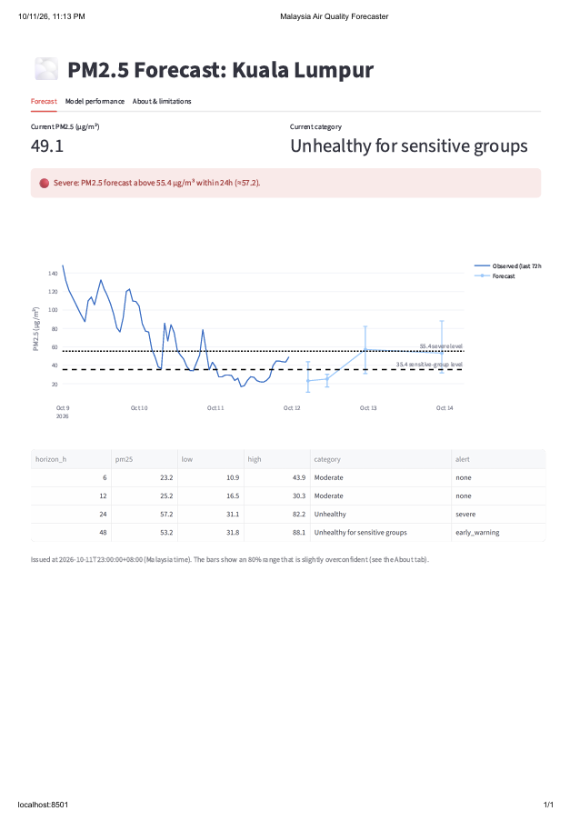

# 🌫️ Malaysia PM2.5 Air Quality Forecaster

**Live dashboard:** https://malaysia-air-quality.streamlit.app

## Problem
Haze and poor air quality affect people with asthma, outdoor workers and event
planners. This project forecasts hourly PM2.5 for Kuala Lumpur 6, 12, 24 and 48
hours ahead, with an 80% uncertainty range and a two-level alert (early warning
and severe).

## Architecture
Open-Meteo data -> cleaning -> leakage-safe features -> LightGBM (point forecast
plus 10th/90th percentile models) -> FastAPI service + Streamlit dashboard.
Tests and a Docker build run in GitHub Actions.

## Data
- Source: Open-Meteo. Air quality comes from the CAMS atmospheric **model**, not ground sensors.
- 36,568 hourly rows, Aug 2022 to Oct 2026, Kuala Lumpur (KL time).
- A 60-hour constant-value artifact (13-16 Dec 2022) was detected and excluded.

## Method
- Features: PM2.5 lags, rolling mean/std, hour and month encodings, weather.
- Chronological 70/15/15 split with a gap equal to the forecast horizon.
- An automated test checks that features use no future information.
- Early-warning trigger tuned on validation data only, scored with F2 (recall-weighted).

## Results (held-out test set, Feb-Oct 2026)

| Horizon | Best baseline MAE | LightGBM MAE | Improvement | Severe recall | Severe precision | 80% interval coverage |
|---|---|---|---|---|---|---|
| 6h | 15.85 | 12.04 | 24.1% | 0.92 | 0.56 | 71.6% |
| 12h | 15.85 | 13.38 | 15.6% | 0.88 | 0.54 | 72.6% |
| 24h | 15.84 | 13.64 | 13.9% | 0.90 | 0.49 | 74.7% |
| 48h | 17.89 | 14.31 | 20.0% | 0.82 | 0.52 | 73.9% |

MAE in µg/m³. The baseline is the better of "persistence" and "same clock time
yesterday". Severe = PM2.5 above 55.4 µg/m³.

## Limitations
- Severe episodes (above about 100 µg/m³) are underpredicted.
- The 80% interval actually covers about 72-75% of outcomes.
- The early warning favors recall over precision, so roughly half of alerts are false alarms.
- Trained on Kuala Lumpur only.
- Training used archived weather; live use relies on weather forecasts. I have not measured that effect.
- Informational only, not medical advice.

## Run locally
    pip install -r requirements.txt
    python -m src.data
    python -m src.train
    streamlit run app/dashboard.py

## Future work
Other Malaysian cities, ground-sensor validation, logging live forecasts to measure real-world accuracy.